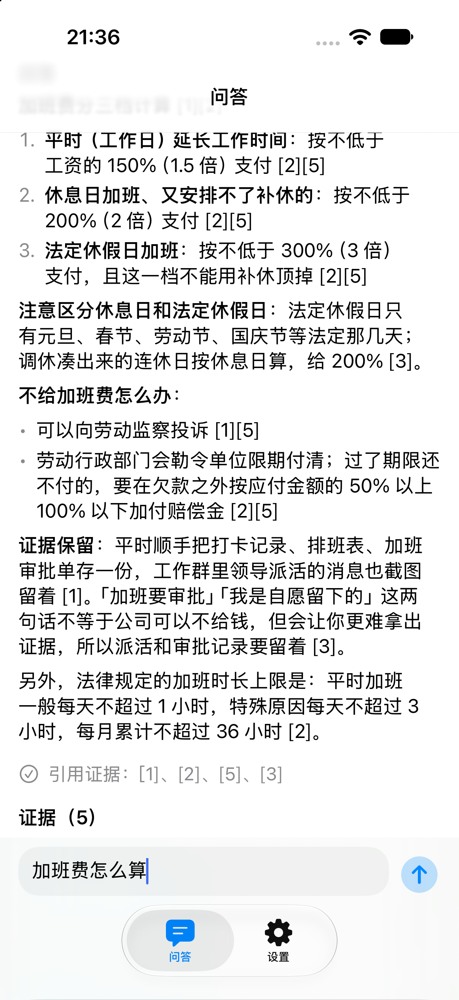
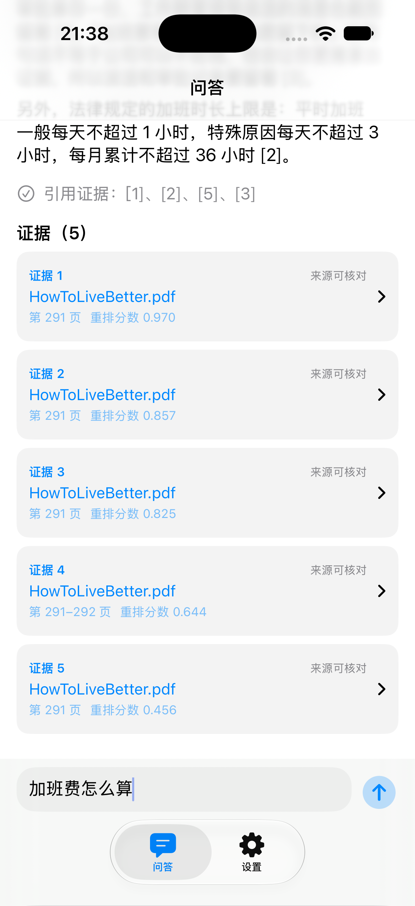

# LlamaIndex RAG

用 LlamaIndex 构建的可追溯 PDF 知识库，按加载、切片、索引、检索、重排、回答、局域网接口的顺序逐段实现，用来学习 RAG 的各个环节。每个阶段都能独立运行，输出完整正文、PDF 物理页码和来源核验结果，可以回到原文件人工核对；检索和回答结果不会脱离原文单独存在。

项目面向学习和分阶段验证，不是生产方案：已知限制和生产待办记录在 [`docs/knowledge/`](docs/knowledge/)，实验参数与结果在 [`docs/experiments/`](docs/experiments/)，功能范围和验收标准见 [PRD](docs/prd/PRD.md)。

| 问答页：流式回答与引用 | 引用检查与证据列表 |
| --- | --- |
|  |  |

**环境要求**：Python 3.12 和 [uv](https://docs.astral.sh/uv/)。加载、切片、索引和 dense 检索只在本地运行；首次需下载本地模型（dense 约 100 MB，重排约 2 GB）；回答会调用可配置的 OpenAI 兼容服务并产生费用，密钥只从环境变量读取。

## 目录

- [Quickstart：首次检索](#quickstart首次检索)
- [从哪里开始读代码](#从哪里开始读代码)
- [安装依赖](#安装依赖)
- [运行日志](#运行日志)
- [文档加载](#文档加载)
- [文本切片](#文本切片)
- [向量化与索引](#向量化与索引)
- [检索](#检索)
- [回答](#回答)
- [局域网接口](#局域网接口)
- [许可](#许可)

## Quickstart：首次检索

需要 Python 3.12 和 `uv`。以下步骤用仓库附带的 PDF 第 291–292 页建立一个小型本地索引，再检索一个文档内问题；只运行本地 embedding，不需要生成模型密钥，也不会把问题或文档发送到外部服务。

```bash
uv sync
uv run hf download BAAI/bge-small-zh-v1.5 --revision 7999e1d3359715c523056ef9478215996d62a620
uv run python -m src.rag.cli.indexing build data/quickstart-index docs/pdf/HowToLiveBetter.pdf --start 291 --end 292
uv run python -m src.rag.cli.retrieval search data/quickstart-index \
  "加班费、年休假该怎么算？" --dense-only --top-k 5
```

首次下载模型需要联网；已有相同快照时，下载命令会复用本地缓存。**必须先看到索引命令输出“索引完成”，再运行检索命令**；如果只运行检索命令，或索引目录名不一致，会收到“索引不存在”的错误。索引输出目录必须尚不存在；重复体验时请换一个新的目录名。检索结果会显示完整片段、PDF 物理页码和来源状态，可打开 PDF 对照第 291–292 页核查。这里使用 `--dense-only` 运行 dense 基线，不需要额外准备约 2 GB 的重排模型。要试自己的 PDF，可替换 PDF 路径、页码范围和问题，并使用新的索引目录；问题及片段仍留在本机，直到使用后面的回答功能。

这一步返回的是检索证据，不是生成式回答。回答功能会把问题和检索片段发送到配置的 OpenAI 兼容服务并产生费用；配置和数据流向见[回答](#回答)。

## 从哪里开始读代码

目前已实现到回答阶段和局域网接口：`PDF → 页面 Document → 切片 Node → 向量和持久化索引 → dense 检索 → 可选重排 → 基于片段的回答 → HTTP 接口`。检索分数和重排分数都不能单独证明候选相关或答案正确，生成模型也不保证回答忠实于原文，仍需人工核对。

1. 从 [加载命令](src/rag/cli/loading.py) 开始，看参数如何传给 [PDF 加载器](src/rag/ingestion/pdf.py)。每个页面的正文和来源信息放在 LlamaIndex `Document` 中；物理页码从 1 开始。
2. 接着看 [切片命令](src/rag/cli/chunking.py) 和 [切片逻辑](src/rag/chunking/split.py)。`Node` 是可索引的片段，继承文件和页码信息；连续页面可以组成跨页片段。[偏移量切分器](src/rag/chunking/offset_splitter.py) 记录片段在拼接原文中的字符位置，以确定覆盖了哪些页面。
3. 接着看 [索引命令](src/rag/cli/indexing.py) 和 [索引存储](src/rag/indexing/store.py)。嵌入模型将每个片段的正文转换成一组数字（向量），`VectorStoreIndex` 保存向量和节点；`manifest.json` 记录构建配置与文档版本。之后可用节点 ID 从已保存的文档库找回原文和来源。
4. 再看 [检索命令](src/rag/cli/retrieval.py) 和 [检索逻辑](src/rag/retrieval/search.py)。检索先核对模型快照和索引配置，再让 LlamaIndex 按 Top-K 查询；默认由本地 CrossEncoder 对 dense 候选重新排序，传入 `--dense-only` 可运行 dense 基线。结果继续使用索引中保存的完整正文与来源元数据。
5. 再看 [回答命令](src/rag/cli/answering.py) 和 [回答逻辑](src/rag/answering/generate.py)。检索片段按顺序编号后交给 OpenAI 兼容的生成模型，回答中的 `[n]` 会与证据逐条核对；密钥只从环境变量读取。
6. 最后看 [服务入口](src/rag/cli/serve.py) 和 [局域网接口](src/rag/api/app.py)。HTTP 层只做参数校验、鉴权和序列化，检索和生成仍调用上面的模块；`stream` 参数决定返回一次性 JSON 还是 Server-Sent Events。

`config/` 集中存放默认值和字段名；来源标识、清单读取、来源核验和页码展示等跨阶段规则集中在 [`provenance/`](src/rag/provenance/verify.py)；`tests/` 展示各阶段的输入、边界和预期。命令行模块负责接收参数及展示结果，阶段目录负责实际处理。下面的命令可以边运行边对照这些文件阅读。

## 安装依赖

需要安装 [uv](https://docs.astral.sh/uv/) 和 Python 3.12。在项目根目录运行：

```bash
uv sync
```

验证环境：

```bash
uv run python -c 'from llama_index.core import SimpleDirectoryReader; from llama_index.readers.file import PDFReader; print("依赖导入成功")'
```

依赖版本记录在 `uv.lock`。

## 运行日志

五个阶段命令行入口会将阶段开始、结束、耗时、参数、数量和失败信息写入 `data/logs/rag.log`。每次命令有独立的 `run_id`，可用它串联加载、切片、索引、检索与回答事件及异常堆栈的每一行；非零退出码以 `WARNING command.finished` 标记；索引日志还记录向量化数量和发布状态。终端继续显示供人工核对的完整正文和来源。日志默认不主动记录正文、切片或向量，但文件路径和第三方异常及堆栈可能包含敏感内容，请按本地资料的保密要求管理日志。

可通过环境变量配置日志文件和级别（`DEBUG`、`INFO`、`WARNING`、`ERROR`）：

```bash
RAG_LOG_FILE=data/logs/debug.log RAG_LOG_LEVEL=DEBUG uv run python -m src.rag.cli.loading docs/pdf/HowToLiveBetter.pdf --start 2 --end 3
```

默认级别为 `INFO`；日志达到 5 MiB 时轮转，保留 3 个旧文件。`data/` 已被 Git 忽略。无法创建或写入日志时会在标准错误提示，业务操作继续执行；日志可能不完整。当前文件轮转面向单进程命令，不保证多个进程同时写同一文件时的完整性；并发运行时请为每个进程设置不同的 `RAG_LOG_FILE`。自动化测试使用临时日志，不写入日常日志；日志只覆盖项目显式记录的事件，并不等同于 LlamaIndex 内部完整调用追踪。作为库直接调用阶段函数时，日志由调用方配置。当前阶段均在命令所在的线程执行；未来若将阶段任务交给线程，须在提交每个任务时使用 `src.rag.cli.logging.bind_log_context` 包装任务，并在命令退出前等待任务结束，才能关联运行 ID。

## 文档加载

在项目根目录运行以下命令，查看测试文档的第 2 至 3 个物理页面（页码从 1 开始，包含结束页）：

```bash
uv run python -m src.rag.cli.loading docs/pdf/HowToLiveBetter.pdf --start 2 --end 3
```

省略页码参数可检查全文；替换路径即可加载其他 PDF。输出包含完整页面文本、文件路径、物理页码和成功、空文本、失败页统计。对照 PDF 检查中文和段落顺序；空文本页需要人工确认。失败页不影响其他页面处理，但命令返回非零状态。暂不支持 OCR，扫描件或图片中的文字可能无法提取。

```bash
uv run python -m unittest discover -s tests -v
```

本模块使用 LlamaIndex `BaseReader` 和 `Document`，通过 `pypdf` 逐页提取文本。这样可以选择页码范围并报告单页失败；`Document.metadata` 保留文件路径、文件标识及物理页码。文件标识由绝对路径生成，移动文件后标识会变化。

## 文本切片

在项目根目录运行，查看第 5 页的完整切片及相邻片段：

```bash
uv run python -m src.rag.cli.chunking docs/pdf/HowToLiveBetter.pdf --start 5 --end 5 --chunk-size 128 --chunk-overlap 32
```

将参数改为 `--chunk-size 256 --chunk-overlap 64`，可对照同一页的边界。省略 `--end` 会处理到末页；替换路径可检查其他 PDF。默认大小为 512、重叠为 64，单位是 LlamaIndex 默认 tokenizer 的 token，长度统计针对片段正文；重叠为上限，实际取决于句子边界。配置须满足大小大于 0，且 `0 ≤ 重叠 < 大小`。输出包含完整文本、片段编号、运行时节点 ID、文件路径、物理页码及长度统计；节点 ID 每次运行会重新生成。空页和失败页会明确列出，失败页使命令返回非零状态。

切片先在行首项目符号或编号条目处划出结构块（`src/rag/config/chunking.py` 的 `STRUCTURE_BLOCK_START_REGEX`），让片段边界优先落在条目之间，块内仍然交给 LlamaIndex 切分；PDF 提取的单换行会让默认段落分隔符失效，没有这一步时片段会从“来源 / 备注”行中间开始。规则只看行首符号，换 PDF 无需修改；`①`、`(1)` 这类符号目前不认，遇到时补充该正则即可。

使用 LlamaIndex `SentenceSplitter` 的句子拆分规则切片，通过适配其内部合并步骤记录原文位置；这依赖当前锁定版本的内部接口，升级 LlamaIndex 时应重新验证。同一文件的连续物理页面以换行拼接，切片可跨页；PDF 的 `page_numbers` 是唯一页码来源，单页例如 `[5]`，跨页例如 `[5, 6]`，命令行由它生成位置展示。缺页、空页及不同文件之间不拼接。切片入口目前支持 PDF，要求文件名、来源路径、来源标识及物理页码；其他格式引入时再设计其定位方式。切片大小仅计算正文，来源元数据仍保存在节点中。重叠是最大值，并不保证每个边界或每个观点完整；PDF 提取的页眉、页脚和换行可能干扰阅读，应对照原 PDF。此阶段只做本地处理，不调用模型或外部服务。实验结果和限制见 [切片实验记录](docs/experiments/chunking.md)。

## 向量化与索引

默认快照尚未下载时，可运行 `uv run hf download BAAI/bge-small-zh-v1.5 --revision 7999e1d3359715c523056ef9478215996d62a620` 获取对应版本；自定义安装目录可通过 `RAG_EMBEDDING_MODEL_PATH` 指定。跨阶段共用的模型路径和推理设备集中在 `src/rag/config/common.py`；模型路径可用 `--model-path` 或环境变量临时覆盖，推理设备目前只能修改该配置。

本阶段使用本地 `BAAI/bge-small-zh-v1.5` 和 LlamaIndex `HuggingFaceEmbedding`、`VectorStoreIndex`，将切片正文转换为向量，来源元数据保存在文档库。需要 Python 3.12，运行 `uv sync` 安装依赖；依赖首次下载需要联网并占用磁盘。默认模型快照路径配置在 `src/rag/config/common.py`，CPU 本地推理，不发送文档或问题到外部服务，也不产生模型 API 费用。缓存不存在时需先从可信来源获取相同模型快照，或通过 `--model-path` 覆盖为其他快照目录。程序从缓存目录读取模型名和版本，并对快照文件计算 SHA-256 摘要；目录名本身不能证明模型来源，首次获取时仍应确认下载来源可信。

```bash
uv run python -m src.rag.cli.indexing build data/index-pages-4-5 docs/pdf/HowToLiveBetter.pdf \
  --start 4 --end 5 --chunk-size 128 --chunk-overlap 32
```

构建结束会列出片段 ID 和物理页码。重新加载索引时，可先查看所有文档的覆盖情况，包括没有任何可提取文本的文档：

```bash
uv run python -m src.rag.cli.indexing overview data/index-pages-4-5
```

选择一个片段 ID，重新读取完整正文和来源（无需重新加载 PDF）：

```bash
uv run python -m src.rag.cli.indexing read data/index-pages-4-5 片段ID
```

可在索引路径后传入多个 PDF；页码范围应用于每个文件。索引默认切片大小为 384、重叠为 64，单位是 LlamaIndex tokenizer 的 token；该经验值不保证适用于所有模型和文本。输出目录必须不存在，不能追加或覆盖：重复添加、内容或路径变更时，使用新目录并传入希望保留的全部文档进行受控重建。`manifest.json` 记录文档路径、路径标识、内容 SHA-256、页面范围、空文本页及文本覆盖状态、模型名称、版本和快照内容摘要、维度、切片配置及片段数。空文本页表明文本覆盖不完整，不代表空白页或解析正确；回查会再次提示。路径移动后旧索引仍记录旧位置，需重新构建；旧索引不会自动更新。切片超出嵌入模型长度时会拒绝构建，请减小切片大小。模型长度预检使用已加载的 SentenceTransformer 的 tokenizer 和长度上限，依赖当前锁定版本的 `HuggingFaceEmbedding` 内部模型接口，升级时需重新验证。失败分别报告向量化成功、失败和未处理的数量及索引发布状态；切片尚未生成时未处理数量为未知。临时构建不会作为完整索引发布。原子发布目前支持 macOS 和提供 `renameat2` 的 Linux；其他平台或文件系统不支持该操作时会报错。模型或切片参数更改时必须使用独立目录重建；当前阶段不提供查询或追加，供后续检索模块使用的配置比较函数会拒绝不兼容配置。

测试与类型检查：

```bash
uv run python -m unittest discover -s tests -v
uv run --with mypy python -m mypy --check-untyped-defs src tests
```

索引构建成功不代表语义检索质量达标。第二份 PDF、不同内容版本和路径变化的人工验收仍需后续检查；本地模型、索引和固定问题的检索观察见[检索实验记录](docs/experiments/retrieval.md)。

## 检索

检索使用已保存索引中的向量和 Node，不会重新解析 PDF。默认使用 `src/rag/config/common.py` 配置的 embedding 模型路径；它必须与构建索引时使用的快照一致。需要换模型目录时，可用 `--model-path` 或环境变量 `RAG_EMBEDDING_MODEL_PATH` 覆盖，并确保与索引配置相同。程序会比较模型名、revision 和快照内容摘要，不一致会拒绝查询；向量维度和切片参数由 manifest 记录并随模型身份一同固定，不单独重新推导。

```bash
uv run python -m src.rag.cli.retrieval search data/index-pages-4-5 \
  "如何改善生活质量？" \
  --top-k 5
```

默认结果按重排分数排序，同时显示 dense 原始排名/相似度分数、rerank 分数、片段 ID、完整正文、文件名、来源路径和 PDF 物理页码。两类分数不能互相比较，也不是答案正确率。若使用 `--dense-only`，结果才按向量相似度排序；dense 分数越高表示向量越相似，只能在同一索引和查询配置下比较。索引中缺少正文、文件名或合法物理页码的节点会被排除。源文件已移动或删除时，保存的正文仍会显示，但来源状态会标记为无法完成当前文件核对。

检索默认使用 `src/rag/config/common.py` 中配置的本地 CrossEncoder `BAAI/bge-reranker-v2-m3`，执行 dense top 20 → rerank top 5。`src/rag/config/retrieval.py` 集中管理 `candidate_k` 和 `top_k` 默认值；每次运行可用 CLI 参数覆盖。程序使用 `local_files_only=True`，不会联网下载，也不会把问题或文档发送到外部服务。配置路径不存在时会明确报错；可用 `--rerank-model-path` 临时覆盖配置，或加 `--dense-only` 运行 dense 基线：

首次使用需先安装模型到 Hugging Face 缓存（需要联网并占用约 2 GB），例如运行 `uv run hf download BAAI/bge-reranker-v2-m3 --revision 953dc6f6f85a1b2dbfca4c34a2796e7dde08d41e`。默认配置指向该快照；其他机器或自定义安装目录可在运行命令前设置 `RAG_RERANK_MODEL_PATH=/path/to/model`，也可用 `--rerank-model-path` 覆盖。项目只在本地加载模型，不会自动下载。

首次进行全文检索时，先用完整 PDF 构建索引。索引目录必须不存在；成功后才能运行检索命令：

```bash
uv run python -m src.rag.cli.indexing build data/index-from14-384 docs/pdf/HowToLiveBetter.pdf --start 14
```

默认切片大小为 384 token、重叠 64 token，目录名中的 `384` 只是便于识别参数的名称，不会由程序自动创建。这里的 `--start 14` 跳过了本书的目录、前言和各节简介：这些页只罗列话题、没有操作步骤，却会因为词面重合排到检索前列；各节简介本身横跨 11–13 页，`--start` 只能从某页开始，所以只能连前言 6–10 页一起跳过。前言里有证据等级定义和术语表，需要时再单独建索引。换 PDF 时先看前置页再定起始页。索引构建可能需要约一分钟，并占用约 40 MB 磁盘空间；具体以本机模型和输出为准。若目录已存在，请换一个新目录。

```bash
uv run python -m src.rag.cli.retrieval search data/index-from14-384 \
  "加班费、年休假该怎么算？" \
  --candidate-k 20 --top-k 5
```

输出会同时显示 dense 原始排名和分数、rerank 新排名和分数。两类分数来自不同模型，不能直接比较；重排只能调整已经进入前 20 的候选，不能找回 dense 阶段完全漏掉的片段。使用 `--dense-only` 可在相同问题上运行 dense 基线。

检索验收至少应包含三个文档内有明确依据的问题和一个文档内没有明确答案的问题。对每条结果打开对应 PDF，核对文件、物理页码和完整原文；无结果或来源缺失都要记录，不能仅凭相似度或重排分数判定回答正确。两阶段检索的实验协议和未完成的人工比较见[重排实验记录](docs/experiments/reranking.md)。

用带答案页标注的固定问题集批量统计：

```bash
uv run python -m src.rag.cli.retrieval evaluate data/index-from14-384 docs/experiments/questions.json \
  --candidate-k 20 --top-k 5
```

`docs/experiments/questions.json` 记录问题、答案页和文档外问题；命令输出答案页是否进入 dense 候选，以及它在 dense 和重排前 5 中的名次。名次命中只说明答案页被检索到，片段是否真的支持答案仍要人工核对。当前结果和限制见[检索评测记录](docs/experiments/retrieval-eval.md)。

## 回答

回答命令复用检索或重排结果，把问题和交付的片段发送给 OpenAI 兼容的生成模型，不重新解析 PDF。默认服务是火山方舟的 `glm-5.3-flash`（`https://ark.cn-beijing.volces.com/api/coding/v3`），属于外部服务：问题和片段正文会离开本机，按服务商规则计费；PDF 文件、索引和其他文档不会发送。地址和模型集中在 `src/rag/config/answering.py`，可用 `--api-base`、`--llm-model` 临时覆盖。生成请求默认跟随系统和环境变量代理；如果系统代理无法访问该服务（表现为 `Connection error.`），加 `--no-llm-proxy` 让生成请求直连。

密钥只从环境变量读取，不能写在命令行或配置文件里：

```bash
export ARK_WORK_FLOW_API_KEY="你的密钥"
uv run python -m src.rag.cli.answering data/index-from14-384 \
  "公司拖欠加班费该怎么办？" \
  --candidate-k 20 --top-k 5
```

命令先用 dense top 20 召回并重排取前 5 条作为证据；加 `--dense-only` 可直接使用 dense 结果。证据还要通过相关度门槛：重排结果默认要求 rerank 分不低于 0.3，dense 结果默认要求相似度不低于 0.5；低于门槛的片段会被丢弃并重新编号，全部低于门槛时直接提示资料不足，不调用模型。阈值是经验值，换模型或索引后需要重新校准，可用 `--min-rerank-score`、`--min-dense-score` 调整。输出包括回答、引用编号检查，以及每条证据的文件名、来源路径、物理页码、片段 ID 和完整原文。证据会被标为“已被引用”或“未被引用”；回答引用了不存在的编号，或完全没有引用时，命令会明确提示。检索不到通过来源、正文和相关度检查的片段时，命令直接给出资料不足提示，不调用模型，也不需要密钥。

`--api-key-env` 可改用其他环境变量名。模型返回空回答、输出达到上限（`finish_reason=length`）、鉴权失败或网络错误都会作为失败报告，不会退回本地模型、展示半截回答或编造回答。回答是否忠于原文、是否遗漏限定条件，仍要按引用打开 PDF 人工核对；实验协议和限制见[回答实验记录](docs/experiments/answering.md)。

## 局域网接口

接口让同一局域网内的 iPhone 或其他客户端调用本机的检索、重排和回答能力。客户端不含索引、嵌入模型和云端密钥；所有文档处理和外部模型调用仍在这台机器上完成。接口层不重新实现 RAG 规则，结果与命令行一致。

### 启动服务

```bash
uv run python -m src.rag.cli.serve data/quickstart-index
```

默认只监听 `127.0.0.1:8000`。启动后会打印索引路径、片段数、监听地址、检索参数、生成模型和令牌状态；索引不完整或端口非法时直接退出，不会先监听再报错。

需要手机访问时显式改为监听所有网卡：

```bash
uv run python -m src.rag.cli.serve data/quickstart-index --host 0.0.0.0
```

`0.0.0.0` 会让同网段其他设备也能访问，只在可信网络使用；不要暴露到公网。服务本身不广播地址，手机端也没有自动发现，需要按下一节的方法手动查 IP。

### 生成服务与代理

生成请求默认跟随系统和环境变量代理。macOS 的系统代理会被 Python 的 httpx 读取；代理配置异常时，服务只能看到连接失败，回答页显示“生成回答失败: Connection error.”。如果代理无法访问生成服务而直连正常，启动时加 `--no-llm-proxy`：

```bash
uv run python -m src.rag.cli.serve data/quickstart-index --host 0.0.0.0 --no-llm-proxy
```

启动输出会显示 `生成请求代理: 直连（--no-llm-proxy）`。回答命令也支持同一参数；也可以把生成服务域名加入系统代理的忽略列表。

### 查看本机局域网地址

服务只负责监听，不知道该对外使用哪个地址，需要自己查。Wi-Fi 接口通常是 `en0`：

```bash
ipconfig getifaddr en0
```

输出例如 `192.168.1.10`，手机就访问 `http://192.168.1.10:8000`。

有线网络、iPhone 热点或多个网卡时，接口名可能不是 `en0`。先看默认路由走哪个接口，再查它的地址：

```bash
route -n get default | awk '/interface:/{print $2}'
ipconfig getifaddr "$(route -n get default | awk '/interface:/{print $2}')"
```

也可以打开 系统设置 → 网络（Wi-Fi 则点“详细信息”）直接读取 IP 地址。

如果查到多个 `inet` 地址（VPN、虚拟机、多个网卡），选和手机处于同一网段的那条；`utun*`、`bridge*` 这类接口不是给手机用的。iPhone 个人热点下地址通常是 `172.20.10.x`，手机连上该热点后填这个地址。

查出地址后先确认监听范围：

```bash
lsof -nP -iTCP:8000 -sTCP:LISTEN
```

显示 `*:8000` 表示监听所有网卡；只显示 `127.0.0.1:8000` 时手机连不上，需要按上面的命令加 `--host 0.0.0.0` 重启。

最后用手机 Safari 打开 `http://<IP>:8000/health`，返回 JSON 说明网络通，再把同一地址填进 App。IP 由路由器分配，换网络或续租后可能变化，届时重新查一次并更新 App 里的地址。

### 访问令牌

默认不鉴权。设置 `RAG_API_TOKEN` 后，除 `GET /health` 外的请求都必须带 Bearer Token：

```bash
RAG_API_TOKEN='自己设定的令牌' uv run python -m src.rag.cli.serve data/quickstart-index --host 0.0.0.0
```

```bash
curl -s http://127.0.0.1:8000/search \
  -H 'Authorization: Bearer 自己设定的令牌' \
  -H 'Content-Type: application/json' \
  -d '{"question":"年休假有多少天？","top_k":2}'
```

令牌缺失或错误返回 401。服务只在内存中比较环境变量里的令牌，不写入日志或响应。

### 接口

| 方法 | 路径 | 说明 |
| --- | --- | --- |
| GET | `/health` | 返回索引路径、片段数、模型身份、索引是否可用和是否需要令牌；不需要鉴权 |
| POST | `/search` | 返回带来源的候选片段，不调用生成模型 |
| POST | `/ask` | 基于候选片段生成回答；`stream` 参数控制返回形式 |
| GET | `/v1/models` | OpenAI 兼容的模型列表；声明一个可用标识 `rag` |
| POST | `/v1/chat/completions` | OpenAI 兼容的对话接口；复用检索、相关度过滤和生成 |

`/search` 返回原始候选，便于排查低分结果；`/ask` 在生成前应用同一套相关度门槛（启动参数 `--min-rerank-score` 默认 0.3、`--min-dense-score` 默认 0.5）。全部候选低于门槛时，`/ask` 返回 `llm_called: false` 的资料不足回答，证据列表为空，不调用生成模型。

`/search` 和 `/ask` 使用相同的请求体：

```json
{
  "question": "年休假有多少天？",
  "top_k": 2,
  "candidate_k": 20,
  "dense_only": false,
  "stream": false
}
```

- `top_k`：交付片段数量，1–20，默认 5；`/ask` 中同时是证据数量。
- `candidate_k`：重排前的 dense 候选数量，1–100，默认 20；`dense_only` 为真时忽略，且不得小于 `top_k`。
- `dense_only`：跳过重排，只返回 dense 结果。
- `stream`：只对 `/ask` 生效。`false`（默认）返回一次性 JSON；`true` 返回 Server-Sent Events。

问题去掉首尾空白后不能为空，最多 2000 个字符；超限直接返回 400，不截断后继续。

### 示例

```bash
curl -s http://127.0.0.1:8000/health

curl -s -X POST http://127.0.0.1:8000/search \
  -H 'Content-Type: application/json' \
  -d '{"question":"年休假有多少天？","top_k":2}' | python3 -m json.tool

curl -s -X POST http://127.0.0.1:8000/ask \
  -H 'Content-Type: application/json' \
  -d '{"question":"年休假有多少天？","top_k":2}' | python3 -m json.tool
```

### OpenAI 兼容接口

Chatbox、Cherry Studio 等客户端可以直接把服务地址填成 `http://<主机>:8000/v1`，密钥可留空；服务端设置了 `RAG_API_TOKEN` 时填入同一个值。`GET /v1/models` 返回标识 `rag`；`POST /v1/chat/completions` 取 `messages` 中最后一条非空 user 内容作为问题，检索、相关度过滤和生成规则与 `/ask` 一致。

```bash
curl -s http://127.0.0.1:8000/v1/models

curl -s -X POST http://127.0.0.1:8000/v1/chat/completions \
  -H 'Content-Type: application/json' \
  -d '{"model":"rag","messages":[{"role":"user","content":"年休假有多少天？"}]}' | python3 -m json.tool
```

OpenAI 协议没有结构化的证据字段，因此回答末尾会附上被引用证据的文件名和页码，例如 `[1] HowToLiveBetter.pdf 第 291–292 页`。请求里的 `model`、`temperature` 等字段只用于回显或忽略，实际模型和生成参数由启动配置决定。流式请求使用标准的 `chat.completion.chunk`，并以 `data: [DONE]` 结束。

检索和回答都复用已保存的索引；问题不会被重新解析成文档，也不会写入服务端日志（只记录问题长度和片段数量）。`/ask` 会把问题和证据发送到配置的生成服务并产生费用，密钥只从环境变量读取。第一次请求需要加载 embedding 和重排模型，通常要多等几秒。

### 流式回答

生成阶段可能持续十几秒，加上 `"stream": true` 可以逐段拿到文本。响应是 Server-Sent Events，`curl` 必须加 `-N` 才能看到增量：

```bash
curl -sN -X POST http://127.0.0.1:8000/ask \
  -H 'Content-Type: application/json' \
  -d '{"question":"年休假有多少天？","top_k":2,"stream":true}'
```

事件顺序：

| 事件 | 内容 |
| --- | --- |
| `status` | `{"stage":"retrieving"}` 或 `{"stage":"generating"}`，表示当前阶段 |
| `evidence` | `{"items":[...]}`，检索完成后立刻下发证据，客户端可先展示来源 |
| `delta` | `{"text":"..."}`，生成文本增量，只含最终回答，不含模型推理内容 |
| `done` | 完整回答、`citations`、`invalid_citations` 和证据，字段与非流式响应一致 |
| `error` | `{"detail":"..."}`，流开始后的检索或生成失败 |

流一旦开始，HTTP 状态码已经发出，后续失败只能通过 `error` 事件报告；鉴权、参数和索引检查在开始发送前完成，仍是普通 401/400/404。回答被截断（`finish_reason=length`）或为空时按失败处理，发 `error` 事件，不会把半截文本当成完整回答。

### 错误码

| 状态码 | 场景 |
| --- | --- |
| 400 | 问题为空或超长、`top_k`/`candidate_k` 越界、`top_k` 大于 `candidate_k`、字段类型错误 |
| 401 | 设置了令牌但请求缺失或携带错误 |
| 404 | 索引目录不存在、缺少 `manifest.json` 或索引未完成 |
| 502 | 生成模型调用失败，例如网络错误、鉴权失败或返回空回答 |
| 503 | 索引与模型不兼容、模型目录不存在、生成服务未配置密钥 |

错误响应是 `{"detail":"中文说明"}`，不会返回密钥、堆栈或无关的本机路径。

## 许可

本仓库代码使用 [MIT 许可证](LICENSE)。

示例文档 `docs/pdf/HowToLiveBetter.pdf` 不适用 MIT：它来自《高性价比人生指南》
（https://github.com/eternity4719/HowToLiveBetter），作者 eternity4719，
正文以 [CC BY 4.0](https://creativecommons.org/licenses/by/4.0/) 授权。
仓库中的 PDF 构建于 2026-10-09（Typst 0.15.1），本项目未改动正文内容；
不同时间构建的版本页码可能不同，引用原文时请以上游仓库为准。
