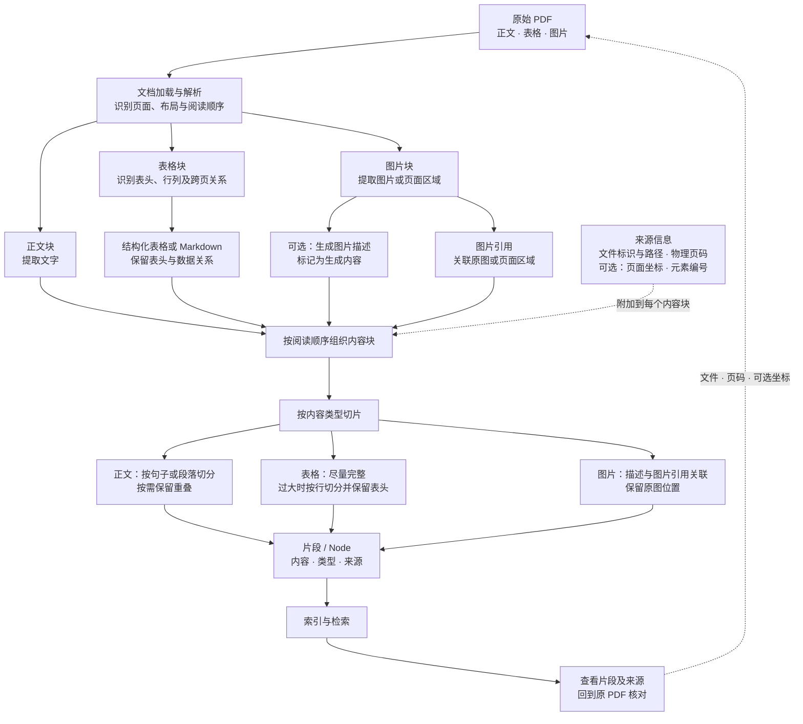

# 复杂 PDF：从解析到可溯源切片

下面是处理包含正文、表格和图片的 PDF 的一种设计思路，**不是当前项目已经实现的能力**。目前项目按页提取 PDF 文本并切片，尚未实现表格结构解析、图片提取或图片描述。

## 重绘流程图


[查看 SVG 原图](images/02-complex-pdf-flow.svg)

## 原 Mermaid 流程图



## 内容如何对应原 PDF

解析器可以按阅读顺序组织内容块，而不是把图片和表格的信息无区别地拼成一段文本。例如：

```text
PDF 第 12 页
├── 正文块：……                来源：第 12 页
├── 表格块：表头和数据……      来源：第 12 页、表格区域
└── 图片块：图片引用 + 描述   来源：第 12 页、图片区域
```

每个块至少应保留来源文件标识、可访问的文件位置和从 1 开始的物理页码；坐标、元素编号和阅读顺序可在解析器可靠提供时补充。切出的片段继承其覆盖内容的来源；跨页表格或片段要记录实际覆盖的页码。来源缺失、阅读顺序不确定或解析失败时应明确提示，不能编造位置。

表格的 Markdown 是对原表格的结构化提取，复杂的合并单元格、跨页表头或图表中的数据可能丢失或识别错误，需要对照原 PDF 检查。图片描述可能由模型生成，应与原文及 OCR 提取文字区分，不能将生成描述当作 PDF 原文；仅有图片引用时，文字检索未必能检索到图片内容。

切片完成后，索引和检索应保留这些来源信息，供使用者查看原文件、页面和原文或原图。使用外部解析、OCR 或视觉模型之前，应确认发送的数据、配置和成本。

## LlamaIndex 的组件与集成

LlamaIndex 提供文档解析、节点处理和多模态相关组件，可以组合使用；具体能力取决于解析器、模型和安装版本。下表基于当前项目的 `llama-index-core 0.14.25` 及现有 PDF 集成整理，外部服务的功能与配置应以其官方文档为准。

| 内容或阶段 | 相关组件与集成 | 作用与限制 |
| --- | --- | --- |
| 普通 PDF 文本 | `PDFReader`；也可实现自定义 Reader | 当前安装的 `PDFReader` 使用 `pypdf` 提取文本，不等于高保真表格或图片解析。项目当前采用自定义按页 Reader，保留物理页码。 |
| 复杂版面与表格解析 | [LlamaParse](https://developers.llamaindex.ai/python/cloud/llamaparse/) 解析服务及其集成 | 可用于更复杂的文档解析；需核对服务配置、数据流向、费用、输出格式及页码。表格结构和阅读顺序仍需人工验证。 |
| 解析后的 Markdown 表格 | `MarkdownElementNodeParser` | 处理已有 Markdown 中的元素，包括表格；它不是 PDF 解析器。表格摘要等处理涉及 LLM 配置，需核对所用模型和成本。 |
| 图片与图文内容 | LlamaIndex 多模态文档、节点和模型集成 | 可组合解析器与多模态模型处理图片；图片提取、生成描述和图文检索各是独立步骤，能力取决于具体集成。 |
| 扫描页与图中文字 | 支持 OCR 的解析服务或 Reader 集成 | OCR 质量受扫描质量、语言和版面影响；需检查漏字、乱码与来源页码。 |
| 已有文档结构 | `MarkdownNodeParser`、`HTMLNodeParser`、`JSONNodeParser` 等 | 利用输入格式的结构生成节点；前提是上游解析已保留可靠结构。 |

其他复杂内容还包括多栏排版、跨页表格、合并单元格、图表与图例、公式、脚注、页眉页脚、嵌套列表及手写内容。提取图表图片、识别图中文字、读出曲线或数值属于不同层次的任务，不能仅凭图片已提取就认为数据已被正确理解。

后续实践可选定同一组含表格和图片的固定页面，对比普通文本提取与结构化解析，记录使用的组件、配置和费用，并人工核对阅读顺序、表头关系、图片内容及物理页码。该对比尚未在本项目中完成。
