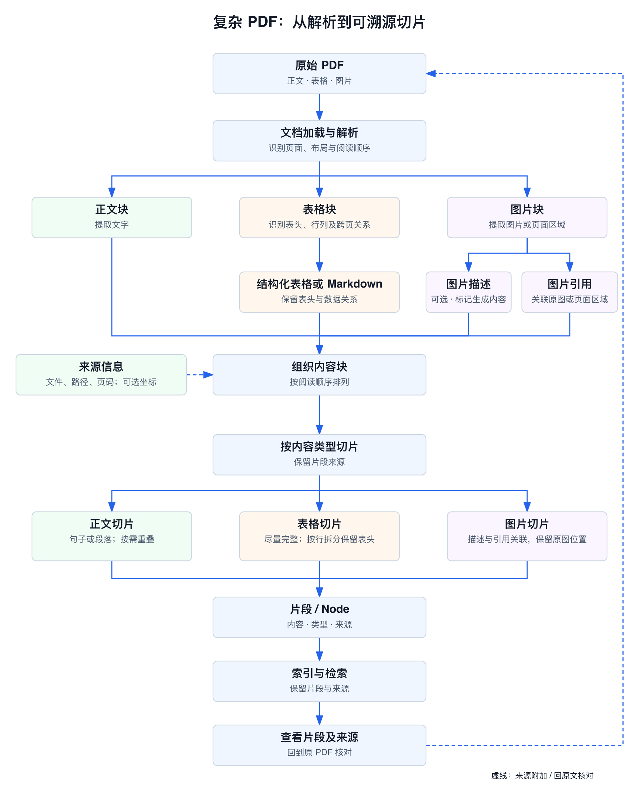
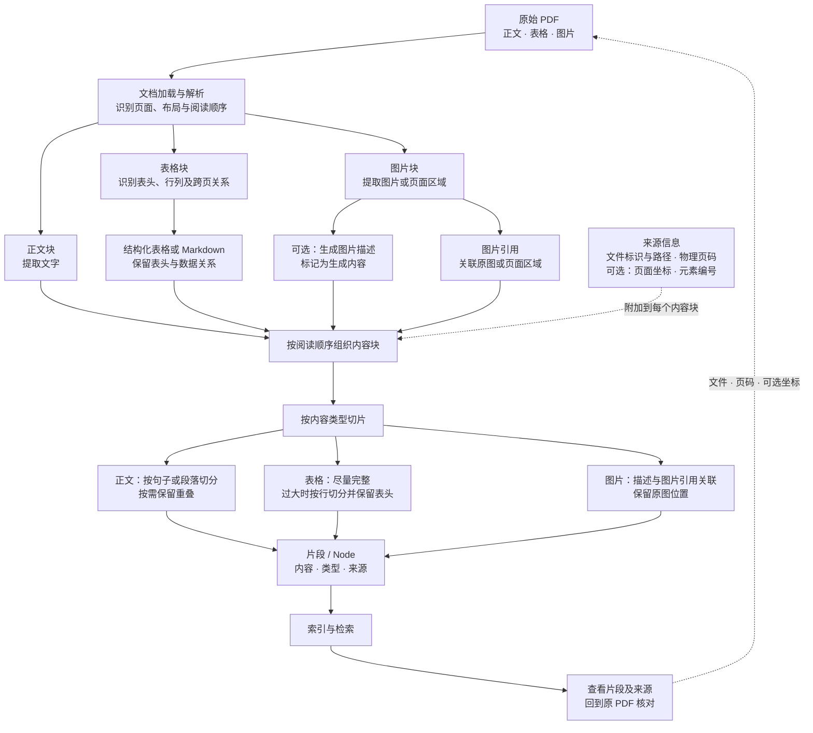

# 复杂 PDF：从解析到可溯源切片

下面是处理包含正文、表格和图片的 PDF 的一种设计思路，**不是当前项目已经实现的能力**。目前项目按页提取 PDF 文本并切片，尚未实现表格结构解析、图片提取或图片描述。

## 重绘流程图



[查看 SVG 原图](images/02-complex-pdf-flow.svg)

## 原 Mermaid 流程图



## 内容如何对应原 PDF

解析器可以按阅读顺序组织内容块，而不是把图片和表格的信息无区别地拼成一段文本。例如：

```text
PDF 第 12 页
├── 正文块：……                来源：第 12 页
├── 表格块：表头和数据……      来源：第 12 页、表格区域
└── 图片块：图片引用 + 描述   来源：第 12 页、图片区域
```

每个块至少应保留来源文件标识、可访问的文件位置和从 1 开始的物理页码；坐标、元素编号和阅读顺序可在解析器可靠提供时补充。切出的片段继承其覆盖内容的来源；跨页表格或片段要记录实际覆盖的页码。来源缺失、阅读顺序不确定或解析失败时应明确提示，不能编造位置。

表格的 Markdown 是对原表格的结构化提取，复杂的合并单元格、跨页表头或图表中的数据可能丢失或识别错误，需要对照原 PDF 检查。图片描述可能由模型生成，应与原文及 OCR 提取文字区分，不能将生成描述当作 PDF 原文；仅有图片引用时，文字检索未必能检索到图片内容。

切片完成后，索引和检索应保留这些来源信息，供使用者查看原文件、页面和原文或原图。使用外部解析、OCR 或视觉模型之前，应确认发送的数据、配置和成本。
